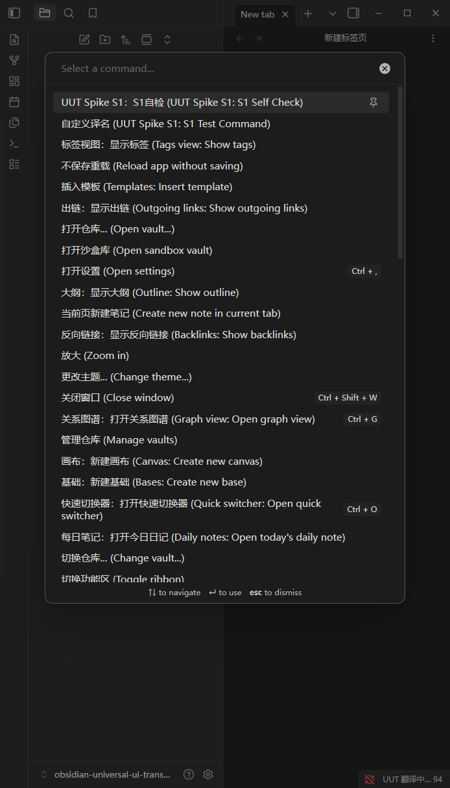
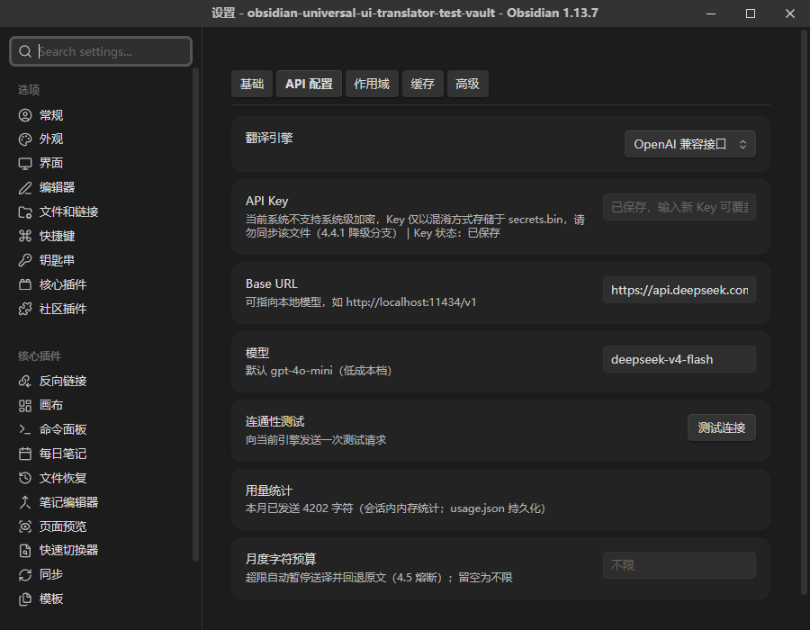

# Universal UI Translator

**用自己的翻译 API 翻译 Obsidian 核心与社区插件界面。**
**Translate Obsidian core and community plugin UI with your own translation API.**

[中文](#中文) · [English](#english)

> **问题反馈 / Feedback**：使用中遇到任何问题（翻译异常、功能建议、Bug）请发邮件至 **[ganmuyun@foxmail.com](mailto:ganmuyun@foxmail.com)**——请附上 Obsidian 版本、插件版本与控制台报错截图，便于定位。
> Found a bug or have a suggestion? Email **[ganmuyun@foxmail.com](mailto:ganmuyun@foxmail.com)** — please include your Obsidian version, plugin version and any console errors.

[](https://github.com/GarrettFynn/obsidian-universal-ui-translator/releases)
[](https://github.com/GarrettFynn/obsidian-universal-ui-translator/actions/workflows/release.yml)
[](LICENSE)



---

## 中文

> 第一次接触 Obsidian？推荐阅读面向新手的详细图文说明：[docs/使用说明.md](docs/使用说明.md)

### 这是什么

Obsidian 社区插件生态以英文为主，汉化依赖插件作者自觉。本插件是一个**界面文本中间件**：拦截 Obsidian 核心与社区插件输出的界面文本，调用**你自己配置**的翻译 API 完成翻译，再按你的偏好写回界面——无需等待插件作者汉化。

插件本体**不含任何翻译引擎或词库**，翻译质量与成本由你选择的 API 决定。

### 功能特性

- **四条拦截通道**：命令面板（含核心命令）、右键菜单、设置面板、MutationObserver 全局兜底（Notice、状态栏、Modal、自定义视图）
- **五种翻译引擎**：OpenAI 兼容接口（含自定义 Base URL / 本地模型）、DeepL、Google Cloud Translation、Azure Translator、自定义 HTTP 端点（Ollama / LM Studio，零成本）
- **合批高速翻译（v1.2）**：OpenAI 兼容通道把单行短文本编号合批（40 条/请求），首译请求数 ÷30+、token ÷5–8，核心界面全量首译从分钟级降到秒级；解析失败自动降级逐条，结果永远可靠
- **本地缓存（升级不清空）**：内存 LRU + 磁盘 JSON 同一上限（默认 5 万条、可调至 20 万，磁盘另有 64MB 字节硬顶），键含原文 + 引擎 + 语言 + 模型——同一界面二次打开零 API 调用；v1.2 起 **Obsidian / 插件升级不再清空缓存**（文本未变即命中），按最近访问淘汰，另有 `.bak` 兜底副本（主文件损坏可恢复）
- **token 实测统计与费用（v1.3）**：直接采集 API 返回的 usage 字段（账单口径，含每请求 system prompt 开销）——主窗口状态栏常驻 `▲ 速率 · 今日 tokens · ≈费用`，社区市场弹窗右下角同源徽标；用量页有会话速率/峰值、今日/本月费用（填入你的单价即显示）与近 30 天双口径图表
- **市场翻译进度反馈（v1.2）**：「译」按钮显示确定型 `已译/总数` 计数，弹窗右下角悬浮进度条（多趟聚合、完成即淡出）——长 README 翻到哪一目了然
- **三种显示模式**：纯译文 / 双语对照 / 原文，随时切换，另有「临时显示原文/恢复译文」命令
- **智能过滤**：跳过代码、路径、URL、数字、已本地化文本；占位符保护 + 译后校验（占位符不一致的译文直接丢弃、不进缓存）；嵌套重译防线已泛化至全部目标语言（v1.4）——译文含目标语言文字 ≥2 字符即拒绝送译，双语回写产物另设结构防线
- **翻译模式与成本治理（v1.6）**：**效率优先（默认）**——跳过其他插件的 Notice 弹窗提示（批量任务的通知最耗 token 且弹窗几秒即逝，此前每条通知都是一次真实 API 消耗）；**效果优先**——尽量翻译一切可见文本。数字模板（如 "New preset: 540/1234"）归一化后同模板只付一次钱、后续全部缓存秒回，模型吞改数字的残缺译文一律拒收不进缓存；效率档下翻译队列高峰（>30 条）时兜底通道自动暂停新请求，菜单/命令面板/市场手动翻译不受影响；「成本审计日志」开关把每条送译明细打进 Console——自查谁在烧 token、反馈问题附日志即定位
- **成本控制**：100ms 批量聚合、全局真实在途并发限制（v1.2 起设置值=实际请求数）、单请求超时（可配置）、月度字符预算自动熔断；429 限流不计入熔断（v1.2），熔断期间状态栏常驻倒计时
- **缓存治理（v1.1.9）**：缓存分页逐项写清"是什么 / 什么时候用 / 代价"——立即落盘、按当前引擎/语言/模型一键清理失效条目、磁盘文件实况、导出/导入共享
- **作用域控制**：核心/社区开关、插件白名单/黑名单、拦截器独立开关、自定义跳过正则与术语表（固定译法优先于缓存与 API）
- **社区插件市场按需翻译（核心功能）**：列表条目与详情面板（README 全文）各有「译」按钮，点哪条译哪条，缓存命中零成本——v1.1.5 起市场默认**不再**自动全量翻译（滚动列表会持续消耗 API），逐条按需是唯一推荐路径
- **费用透明**：设置页逐项标注 API 消耗风险与量级估算；完整折算模型见下方「费用估算」专节
- **目标语言任意**：默认简体中文，可填 `ja` / `zh-Hant` / `ko` / `fr` 等任意语言代码，常用 12 语言快速下拉即选即存；缓存按语言隔离，随时切换互不影响
- **插件界面语言（v1.4）**：跟随 Obsidian / 中文 / English 三档可选——英文界面为全量覆盖包（250 键），命令名、状态栏、设置页与错误消息全覆盖；默认跟随 Obsidian，中文默认体验零回归
- **配置热生效**：改配置即重置熔断并全量重扫界面，无需重启；**落盘三保险（v1.5）**——每批翻译结算后约 1~5 秒即写盘、退出 Obsidian 时同步落盘（正常关闭零丢失）、临时文件原子替换防写坏；崩溃/强杀最多丢最后几秒
- **隐私优先**：无遥测、无外发请求（除你配置的翻译端点）；API Key 经 safeStorage 加密

### v1.6.0 更新：其他插件的弹窗不再烧 token

有用户反馈：批量图片压缩类插件跑批量任务时，**每处理一张图就弹一条英文通知（如 "New preset: 540/1234"），每条都在真实消耗翻译 API 的 token，而弹窗几秒即逝、译文根本来不及显示**——钱花了，效果从没见过。v1.6.0 针对这类"隐形消耗"做了整套成本治理（本版实测对照：300 条此类弹窗，token 消耗 **0**）：

1. **翻译模式（新设置）**：**效率优先（默认）**——跳过其他插件的 Notice 弹窗提示；**效果优先**——尽量翻译一切可见文本。设置 → 基础 → 翻译模式，切换即时生效，无需重启
2. **Notice 弹窗跳过（效率档）**：批量任务的通知不再送译（它们是最典型的"白耗 token"：存活仅几秒、译文回写赶不上、且模板重复量极大）
3. **数字模板归一化（两档共享）**：像 "New preset: 540/1234"、"Page 5 of 10" 这类带动态数字的提示，数字会被保护性替换后送译——**同一种提示只付第一次的钱，之后全部命中本地缓存**并按当前数字精确还原（540、541 各自显示正确）。模型吞改数字的残缺译文会被校验拒收、绝不进缓存
4. **批量高峰自动降级（效率档）**：翻译队列深度（含在途批次）超过 30 时，DOM 兜底通道暂停发起新 API 请求，队列回落自动恢复；菜单、命令面板、设置页、社区市场手动「译」按钮等主动操作**不受任何影响**
5. **成本审计日志（新设置，默认关）**：开启后每条送译请求在开发者控制台（Ctrl+Shift+I）打印明细——哪条文本、哪个通道、多少字符，自查"谁在烧 token"一目了然，反馈问题时附上日志即可定位

**升级行为变化**：① 升级后默认效率优先，其他插件的弹窗不再翻译——需要翻译弹窗请在设置切「效果优先」（效率档下弹窗内容仍会在效果优先时正常翻译）；② 含数字或占位符（{0}、%s 等）的**存量缓存条目会一次性失效**，下次遇到该文本时重译一次后恢复永久缓存——一次性成本，通常几厘钱以内；③ 效果优先档下，同类弹窗提示**第一条 1~3 秒内显示中文**，之后所有同类提示即时显示。

### 安装

- **官方社区插件目录**（已上架）：设置 → 第三方插件 → 社区插件 → 搜索「Universal UI Translator」
- **BRAT（beta 渠道）**：安装 [BRAT](https://github.com/TfTHacker/obsidian42-brat) 插件 → 「Add Beta plugin」→ 粘贴本仓库地址
- **手动安装**：将 `main.js`、`manifest.json`、`styles.css` 复制到 `<库>/.obsidian/plugins/universal-ui-translator/`

### 配置

1. 打开 **设置 → Universal UI Translator → API 配置** 页
2. 选择引擎并填入 API Key（加密存储于 `secrets.bin`，绝不写入 `data.json`）
3. 点击「测试连接」——成功后拦截层自动激活

| 引擎 | 说明 |
| --- | --- |
| OpenAI 兼容接口 | **推荐 DeepSeek**：Base URL `https://api.deepseek.com` + 模型 `deepseek-v4.1-flash`，并打开「关闭思考模式」开关；默认 `gpt-4o-mini`；支持自定义 Base URL（如接本地 Ollama：`http://localhost:11434/v1`） |
| DeepL | Free/Pro 端点自动识别（Free 版 Key 以 `:fx` 结尾）；免费档 50 万字符/月 |
| Google Cloud Translation | API Key；语言覆盖最广；免费档 50 万字符/月 |
| Azure Translator | Key + Region；免费档 200 万字符/月 |
| 自定义端点 | URL + 请求体模板 + 响应 JSONPath——Ollama / LM Studio / 任意本地模型，零成本 |

典型成本：**接近零**——各厂商免费额度足以覆盖界面文本量；本地模型仅费电。付费引擎下的精确估算见下节。



### 费用估算（以 DeepSeek flash 为基准，2026-09-10 新定价）

DeepSeek flash 系列自 2026-09-10 12:00（北京时间）起的定价（每百万 tokens）：

| | 空闲时段 | 高峰时段（= 空闲 × 2） |
| --- | --- | --- |
| 输入（缓存命中） | ¥0.02 | ¥0.04 |
| 输入（缓存未命中） | ¥1 | ¥2 |
| 输出 | ¥4 | ¥8 |

**折算模型**（界面文本 → tokens）：输入 tokens ≈ 英文字符数 / 4；输出 tokens ≈ 字符数 / 2.5（中文译文 1 token ≈ 1.5 汉字、长度约为原文 60%）。即**每 1 万字符界面 ≈ 2,500 输入 + 4,000 输出 tokens → 高峰约 ¥0.037，空闲半价**。

**每个动作花多少钱**（高峰 / 空闲）：

| 动作 | 字符量 | tokens（入+出） | 费用 |
| --- | --- | --- | --- |
| 市场列表单条目「译」（条目右上角按钮） | ≈150 | 38 + 60 | < ¥0.001，可忽略 |
| 插件详情 README「译」（详情区顶端按钮） | ≈4,000 | 1,000 + 1,600 | ≈ ¥0.015 / ¥0.007 |
| 核心界面全量（一次性，之后走缓存） | ≈8 万 | 2 万 + 3.2 万 | ≈ ¥0.30 / ¥0.15 |
| 市场全列表自动翻译（默认关闭的高风险开关） | ≈30 万/轮 | 7.5 万 + 12 万 | ≈ ¥1.1 / ¥0.55 每轮 |

**token 耗费速率**：批量聚合窗口 100ms + 全局在途并发（默认 3、可调 5）+ 合批 40 条/请求（v1.2）；一键翻译整篇 README（≈2,600 tokens）通常数秒完成。界面翻译不是持续流量——本地缓存命中即零请求，只有"第一次见到"的文本才消耗 tokens，且 v1.2 起 Obsidian / 插件升级不清空缓存（无周期性重译）。

**怎么用到接近零成本**：① 译文本地缓存，同一内容永不再发请求；② 设置页「月度字符预算」超限自动熔断；③ 术语表命中的词条不走 API；④ 用 Ollama 本地模型则完全免费、数据不出本机。

### 用量统计与缓存管理（v1.1.9 起，v1.3 实测口径）

**「用量统计」分页**（设置 → Universal UI Translator）回答"我到底调用了多少 API、烧了多少 tokens"：

- **双口径**：v1.3 起 OpenAI 兼容通道直接记录 API 返回的 usage（**账单口径实测**，含每请求 system prompt 开销）；字符折算估算（输入 ≈ 字符/4、输出 ≈ 字符/2.5）保留服务历史数据与非 token 计费引擎，图表可一键切换两种口径，悬停同显双数值
- **本月汇总**：送译条数、输入/输出字符、实测与估算 tokens（入/出分列）、按 DeepSeek 基准价折算的费用；填入自己的单价（API 配置页 `输入价/输出价`）后另显今日/本月**实测费用**
- **会话实时**：本会话 tokens / 送译条数 / 近 1 分钟与 5 分钟速率 / 峰值速率；主窗口状态栏常驻 `▲ 速率 · 今日 · ≈费用` 段（10 分钟无活动自动隐藏），社区市场弹窗右下角有同源常驻徽标——独立窗口内也能盯住消耗
- **近 30 天柱状图**：每天一根堆叠条（下=输入、上=输出），鼠标悬停查看当天精确数值；另有「今日 / 近 7 日」摘要
- **口径说明**：**缓存命中与术语表命中不消耗 API、不计入此统计**；逐日明细自 v1.1.9 起记录（usage.json 向后兼容扩展，日桶保留近 62 天，月度预算判定口径不变）

**「缓存」分页功能速查**（设置页内每个功能均为"是什么 / 什么时候用 / 代价"三段式说明）：

| 功能 | 是什么 | 什么时候用 |
| --- | --- | --- |
| 启用本地缓存 | 译文持久化到 translation-cache.json，同一文本只付一次费 | 只有排查翻译异常时才需要关 |
| 缓存条目上限 | 内存=磁盘同一容量（默认 5 万，可调 1000–20 万；磁盘另有 64MB 硬顶），超出淘汰最久未用条目 | 市场 README 翻得多就往宽设——纯文本不占空间，上限太低会提前淘汰译文、重复消耗 API；调小立即生效 |
| 缓存统计 | 条数、命中率、磁盘文件实际大小、最后落盘时间 | 命中率越高越省钱 |
| 立即落盘 | 新译文先在内存，v1.5 起每批翻译结算后约 1~5 秒自动写盘、退出 Obsidian 时同步落盘（正常关闭零丢失）、原子替换防写坏，另有 `.bak` 兜底副本；点此立即写入磁盘 | 应急/图安心用——v1.5 起关机重启前**不再需要**手动点；崩溃/强杀最多丢最后几秒新译文 |
| 清理失效条目 | 删除与当前「引擎+语言+模型」不匹配的条目（缓存键含这三维，换模型后旧条目永不命中，纯占空间） | 换过模型/引擎/目标语言之后点一次；v1.1.9 前的旧条目无模型标记，只能按引擎+语言判定 |
| 清空缓存 | 删除全部缓存译文并重置界面译态 | 译文异常（如嵌套乱码）排查、换术语表后重来；⚠️ 之后全部界面重译一遍（核心界面 ≈ ¥0.30 以内） |
| 导出 / 导入 | 缓存与库根目录 JSON 文件互转（FR-12） | 换机迁移、把译文词表分享给他人（对方导入后零成本复用） |

### 翻译速度怎么调

v1.2 起 OpenAI 兼容通道已**合批**（单行短文本 40 条合一次请求），首译速度与 token 消耗大幅下降；仍觉得慢时按见效程度依次检查（都在设置页内）：

1. **打开「关闭思考模式」**（API 配置页，见效最大）：DeepSeek V4、豆包等模型默认先"思考"再输出，UI 短文本无需推理——关掉后响应快一倍不止，还省 tokens。模型选 **turbo / flash 档**，别用 pro 档
2. **最大并发请求数调到 5**（高级页）：v1.2 起该值就是**真实在途请求数**（全局信号量统一封顶；旧版内层还藏了一个并发 3，设 5 实际是 15 路）。⚠️ 不要贪大：并发 10 容易打爆账号每分钟请求限额（HTTP 429）——v1.2 起 429 不再触发 10 分钟熔断（限流是背压不是故障），但仍会被服务商限速拖慢；看到 429 就降回 3。若真触发熔断，状态栏会常驻显示「熔断中 mm:ss」倒计时
3. **批量聚合窗口保持 100**（高级页）：窗口是攒批去重的等待时间，调大（如 455）会让每批白等近半秒，十几批就多等好几秒；调大只能略微减少重复请求，对总字符消耗无影响
4. **显示模式用「纯译文」**（基础页）：双语对照的 LLM 输出长度约为纯译文 2 倍，生成时间直接翻倍；需要对照时再临时切换

预期管理：首次翻译某篇内容慢是正常的（v1.2 合批后一篇插件 README 约 2,600 tokens、数秒完成）；进缓存后再次打开**零延迟**，速度问题只存在于"初见"。若 Console 持续刷 404/429，先解决模型配置（未开通/不存在的模型名会一直失败重试、拖慢整体），再谈提速。

**消耗随时可见**（v1.3）：状态栏常驻用量段（`▲ 34 tok/min · 今日 1.2k tok · ≈¥0.03`，10 分钟无活动自动隐藏）；数字为 API 返回的实测 usage（账单口径）。想看到费用：到 设置 → API 配置 → token 单价（每百万）填入你所用模型的输入/输出价格即可；用量统计页还有会话速率、峰值与近 30 天双口径图表。

**推荐配置一览**：翻译模式 = 效率优先（默认）｜ 关闭思考模式 = 开 ｜ 模型 = qwen3.7-flash（或 DeepSeek flash 档）｜ 批量窗口 = 100 ｜ 并发 = 5 ｜ 超时 = 30000 ｜ 显示模式 = 纯译文

### 低成本模型推荐：几厘钱翻完全部界面

> 下述价格为 **2026-11-16 快照**（qwen3.7-flash 为百炼官方定价页核实价），各家调价频繁，以官方价格页为准：[阿里云百炼价格](https://help.aliyun.com/zh/model-studio/model-pricing) / [DeepSeek 定价](https://api-docs.deepseek.com/zh-cn/quick_start/pricing)。本插件核心界面全量翻译一次约 1 万 tokens，之后全部走缓存且升级不清空——按下列价格，一次全量翻译成本在**分厘级**。

**首选：qwen3.7-flash（阿里云百炼）** —— 低价 flash 档，输出单价约为 qwen-flash 的一半（翻译场景输出占大头，更省），速度快、国内直连，UI 短文本翻译质量绰绰有余：

- 价格（百炼官方定价页 2026-11-16 核实，北京区，≤32K 档——UI 短文本全部落在此档）：输入 **0.2 元 / 输出 0.8 元**每百万 tokens；北京区另有 **100 万 tokens 免费额度**（新用户可直接白嫖全量首译）；上下文缓存另有折扣。来源：[百炼模型价格页](https://help.aliyun.com/zh/model-studio/model-pricing)
- 接入（OpenAI 兼容通道）：**设置 → Universal UI Translator → API 配置** → 引擎选 OpenAI 兼容接口
  - Base URL：`https://dashscope.aliyuncs.com/compatible-mode/v1`
  - API Key：[百炼控制台](https://bailian.console.aliyun.com/)创建
  - 模型：`qwen3.7-flash`
  - 打开「关闭思考模式」——qwen3 系默认开思考，UI 短文本无需推理，关掉更快、更省 tokens（百炼思考模式说明见官方[深度思考文档](https://help.aliyun.com/zh/model-studio/deep-thinking)）

**并列可选：qwen-flash（阿里云百炼）** —— 老牌 flash 档（输入 0.15 元/百万略低，输出 1.5 元/百万约为 3.7 的两倍）：接入方式同上，模型填 `qwen-flash` 即可。

**备选：DeepSeek（deepseek-chat，V4.1 Flash 档）**：

- 价格快照：非高峰输入 $0.15 / 输出 $0.60 每百万 tokens（美元计价、分时段 + 缓存计价，缓存命中极便宜；高峰约翻倍）；Base URL：`https://api.deepseek.com`；务必打开「关闭思考模式」

**完全免费**：本地 Ollama / LM Studio（数据不出本机）；DeepL / Google / Azure 传统翻译引擎的免费档（见上方引擎表）。另外，**经常换模型试探的用户**建议打开设置里的「跨模型/引擎复用缓存」（v1.5 起）——默认每换一次模型同一界面会整体重译一遍，这是最容易忽视的用量放大器。

**术语表**：想固定某些词条的译法（比如特定插件名保留英文），在设置的术语表里加一条即可，命中词条不走 API。

### 安全与隐私

- 无遥测、无分析、无外发请求（除你配置的翻译端点）
- API Key 经 Electron `safeStorage`（操作系统钥匙串）加密存储为 `secrets.bin`，**密文只能在本机解密**——请勿将该文件纳入 Obsidian Sync / git 同步；换机后按设置页提示重新输入即可
- 翻译缓存存于本地插件目录，可自由导出/导入
- 所有原型劫持均做特征检测、可独立开关，并在卸载时完整还原（含实例级补丁）

### 已知限制

- **不支持 Canvas/WebGL 渲染文本**（如 Excalidraw 画布、Graph 关系图）
- **不支持 WebWorker / iframe 内文本**
- **用户内容一律不译**：笔记编辑器、阅读视图、文件名（文件管理器、标签页标题、快速切换器）、大纲、标签、悬浮预览、嵌入笔记、搜索摘录
- **插件黑名单的边界**：命令/菜单/设置通道严格生效；DOM 兜底通道无法识别文本归属，黑名单插件的自定义视图仍可能被翻译（可用跳过正则补充）
- **仅桌面端**（`isDesktopOnly: true`），本版本不支持移动端

### 开发

```bash
npm install
npm run build          # tsc 类型检查 + esbuild（刻意不做 minify）
npm test               # 257 个单元与集成测试
npm run test:coverage  # 核心模块行覆盖率 75.9%–100%
```

### 许可证

MIT，见 [LICENSE](LICENSE)。

---

## English

### What it does

Obsidian's community plugin ecosystem is mostly English-only, and localization depends on each plugin author. Universal UI Translator is a **UI text middleware**: it intercepts interface text from Obsidian core and community plugins, orchestrates translation through a translation API **you configure**, and writes results back to the UI — no waiting for plugin authors to localize.

The plugin ships **no translation engine or glossary of its own**. Translation quality and cost are determined by the API you choose; the plugin only standardizes interception, orchestration, caching, and write-back.

### Features

- **Four interception channels**: command palette (including core commands), context menus, settings panels, and a MutationObserver fallback for Notices, the status bar, modals and custom views
- **Five translation providers**: OpenAI-compatible (incl. custom Base URL / local LLMs), DeepL, Google Cloud Translation, Azure Translator, and a fully custom HTTP endpoint (Ollama / LM Studio — zero cost)
- **Batched high-speed translation (v1.2)**: the OpenAI-compatible channel merges short single-line texts into numbered batches (40 per request) — first-time translation issues ÷30+ fewer requests and ÷5–8 fewer tokens; a full core-UI pass drops from minutes to seconds. Malformed batch responses auto-fall back to per-item requests, so results stay reliable
- **Local-first cache (survives upgrades)**: in-memory LRU + on-disk JSON under one shared cap (default 50k entries, adjustable up to 200k; 64 MB on-disk byte ceiling), keyed by text + provider + language + model — opening the same UI twice issues zero API calls. Since v1.2 Obsidian/plugin upgrades **no longer invalidate the cache** (unchanged text keeps hitting), eviction follows most-recent-use, and a `.bak` copy recovers from a corrupted file
- **Real token metering & cost (v1.3)**: captures the `usage` field returned by the API (billing basis, including per-request system-prompt overhead) — the main-window status bar shows `▲ rate · today · ≈cost`, and the community-plugin browser popup carries the same live badge in its corner; the usage tab adds session rate/peak, today/month cost (enter your own per-million prices) and a dual-basis 30-day chart
- **Marketplace progress feedback (v1.2)**: the "译" button shows a deterministic `done/total` counter while translating, plus a floating progress bar in the popup window (multi-pass aggregate, fades on completion)
- **Three display modes**: translated / bilingual (translation with original in brackets) / original, switchable anytime, plus a "temporarily show original / restore translation" command
- **Smart filtering**: skips code, paths, URLs, numbers and already-localized text; placeholder protection with post-translation validation (mismatched placeholders are discarded, never cached); the nested re-translation guard now covers all target languages (v1.4) — text containing 2 or more characters of the target script is rejected, and bilingual write-back output is blocked by a structural rule
- **Translation mode & cost governance (v1.6)**: **Efficiency-first (default)** — skips Notice popups raised by other plugins (batch-task notices burn the most tokens and vanish in seconds; before v1.6 every notice was a real API charge); **Quality-first** — translates everything visible. Number templates (e.g. "New preset: 540/1234") are normalized so each template is paid for once and later hits resolve from cache instantly, with corrupted outputs (swapped/lost numbers) rejected and never cached; in efficiency mode the DOM fallback channel pauses new requests while the queue is deep (>30), leaving menus, the command palette and manual marketplace translation untouched; a **cost audit log** toggle prints every outbound request to the Console — audit what burns tokens and attach logs to bug reports
- **Cost controls**: 100 ms batch aggregation, a global true in-flight concurrency limit (since v1.2 the setting equals actual requests in flight), per-request timeout (configurable), monthly character budget with automatic circuit-breaker; HTTP 429 no longer trips the breaker (v1.2) and an active breaker shows a live countdown in the status bar
- **Cache governance (v1.1.9)**: the cache tab explains every action in a what/when/cost format — manual flush, one-click purge of entries that no longer match the current provider/language/model, on-disk file size, export/import sharing
- **Scope control**: core/community toggles, per-plugin whitelist/blacklist, per-interceptor switches, custom skip-regexes and a user glossary (fixed translations that bypass cache and API)
- **On-demand marketplace translation**: a "译" button on each community-plugin item translates just that entry — cache hits cost zero API calls. Since v1.1.5 the marketplace no longer auto-translates while scrolling (that high-risk toggle ships off) — on-demand is the recommended path
- **Any target language**: defaults to `zh-CN`; set `ja` / `zh-Hant` / `ko` / `fr` or any language code, with a quick dropdown of 12 common languages — the cache is keyed per language, switch anytime
- **Plugin UI language (v1.4)**: follow Obsidian / Chinese / English — the English UI is a full coverage pack (250 keys) spanning command names, the status bar, settings pages and error messages; defaults to following Obsidian, and the default Chinese experience is unchanged
- **Hot-applied settings**: config changes reset the circuit breaker and rescan the rendered UI instantly — no restart needed. **Triple flush safety (v1.5)**: each finished translation batch hits disk within ~1–5 s, quitting Obsidian flushes synchronously (clean exit loses nothing), and writes are atomic via temp-file rename; a crash loses at most the last few seconds
- **Privacy by design**: no telemetry, no outbound calls except your configured translation endpoint; API keys encrypted with Electron `safeStorage`

### v1.6.0: other plugins' popups no longer burn tokens

A user reported it perfectly: while a batch image-compression plugin chewed through a folder, **every processed image raised an English Notice popup ("New preset: 540/1234") — each one a real, billable translation request, while the popup vanishes in seconds and the translation never lands on screen**. Money spent, nothing ever seen. v1.6.0 ships a full cost-governance pass for this class of invisible spend (measured on a live vault: 300 such popups → **0 tokens**):

1. **Translation mode (new setting)**: **Efficiency-first (default)** — skips Notice popups raised by other plugins; **Quality-first** — translates everything visible. Settings → General → Translation mode; switching applies instantly, no restart
2. **Notice skip (efficiency mode)**: batch-task notifications are no longer sent for translation — they are the textbook token sink (live for seconds, translation can't land in time, hugely repetitive)
3. **Number-template normalization (both modes)**: hints with dynamic numbers ("New preset: 540/1234", "Page 5 of 10") have their numbers masked before translation — **each template is paid for once, every later hit resolves from local cache** with the current numbers restored exactly (540 and 541 each display correctly). Corrupted translations with swallowed/altered numbers are rejected and never cached
4. **Peak-hours throttling (efficiency mode)**: when the translation queue (in-flight batches included) exceeds 30, the DOM fallback channel pauses new API requests until the queue drains; menus, the command palette, settings pages and the marketplace's manual "译" button are **never affected**
5. **Cost audit log (new setting, off by default)**: every outbound request prints a line to the developer console (Ctrl+Shift+I) — which text, which channel, how many characters. Audit what burns your tokens; attach the log when reporting issues

**Upgrade behavior changes**: ① efficiency-first is the new default — other plugins' popups are no longer translated; switch the setting to "Quality first" if you want them; ② existing cache entries containing numbers or placeholders ({0}, %s, …) **invalidate once** and retranslate on next encounter — a one-time cost, typically fractions of a cent; ③ in quality-first mode the first popup of a template shows Chinese within 1–3 s and every later one instantly.

### Installation

- **Community plugin directory** (listed): Settings → Community plugins → Browse → search "Universal UI Translator"
- **BRAT (beta channel)**: install the [BRAT](https://github.com/TfTHacker/obsidian42-brat) plugin → "Add Beta plugin" → paste this repository's URL
- **Manual**: copy `main.js`, `manifest.json`, `styles.css` into `<vault>/.obsidian/plugins/universal-ui-translator/`

### Configuration

1. Open **Settings → Universal UI Translator → API 配置**
2. Pick a provider and enter your API key (encrypted and stored in `secrets.bin`, never in `data.json`)
3. Click **测试连接** — on success, interception activates automatically

| Provider | Notes |
| --- | --- |
| OpenAI-compatible | Recommended: DeepSeek — Base URL `https://api.deepseek.com` + model `deepseek-v4.1-flash` with "关闭思考模式" toggled ON; default `gpt-4o-mini`; custom Base URL supported (e.g. `http://localhost:11434/v1` for Ollama) |
| DeepL | Free/Pro endpoint auto-detected (free keys end with `:fx`); 500k chars/month free |
| Google Cloud Translation | API key; broadest language coverage; 500k chars/month free |
| Azure Translator | Key + region; 2M chars/month free |
| Custom endpoint | URL + request template + response JSONPath — Ollama / LM Studio / any local model, zero cost |

Typical cost: **zero** — the free tiers of all major providers cover UI-text volumes, and local models cost only electricity.

### Cost estimation (DeepSeek flash basis, 2026-09-10 pricing)

Rules of thumb (UI text → tokens): input tokens ≈ English chars / 4; output tokens ≈ chars / 2.5 (a Chinese translation is ~60% of the source length). That is, **every 10k chars of UI ≈ 2,500 input + 4,000 output tokens ≈ ¥0.037 at peak, half that off-peak** (DeepSeek flash pricing since 2026-09-10: input ¥1 / output ¥4 per million tokens off-peak, ×2 at peak).

| Action | Chars | Cost (peak / off-peak) |
| --- | --- | --- |
| Translate one marketplace list entry | ≈150 | < ¥0.001, negligible |
| Translate one plugin README | ≈4,000 | ≈ ¥0.015 / ¥0.007 |
| Full core UI, one-time (then cached forever) | ≈80k | ≈ ¥0.30 / ¥0.15 |
| Auto-translate the whole marketplace list (off by default) | ≈300k/round | ≈ ¥1.1 / ¥0.55 per round |

How it stays near zero: ① translations are cached locally — the same text is never billed twice; ② the monthly character budget trips an automatic circuit-breaker; ③ glossary hits bypass the API entirely; ④ a local model (Ollama / LM Studio) is completely free and never leaves your machine. Since v1.2, Obsidian/plugin upgrades no longer invalidate the cache, so there is no periodic re-translation cost.

For users in China, the 中文 section above has cheap-model picks — as of 2026-11 the top pick is **qwen3.7-flash** on Alibaba Bailian (official pricing: ¥0.2 in / ¥0.8 out per million tokens, ≤32K tier, plus a 1M-token free quota in the Beijing region; see the [Bailian pricing page](https://help.aliyun.com/zh/model-studio/model-pricing)), with qwen-flash and the DeepSeek flash tier as alternatives — a full one-time UI translation costs fractions of a cent. Since v1.5, an opt-in "loose cache key" reuses translations across models/engines, so switching models no longer re-translates everything.

### Usage stats & cache management (v1.1.9+, real token basis in v1.3)

- The **用量统计 (Usage)** tab answers "how much API have I actually used" on two bases: since v1.3 the OpenAI-compatible channel records the `usage` field returned by the API (**billing-basis, exact** — including per-request system-prompt overhead), while character-based estimates (input ≈ chars/4, output ≈ chars/2.5) remain for historical data and non-token providers. The 30-day chart toggles between bases and hovering shows both. Monthly totals cover calls, characters and tokens (measured + estimated); enter your own per-million prices in the API tab to see today/month **measured cost**. Session cards show live rate (1/5-minute windows) and peak, mirrored by the always-on status-bar segment and the badge inside the community-plugin browser popup. **Cache and glossary hits cost no API calls and are not counted**; daily detail is recorded from v1.1.9 onward (usage.json stays backward-compatible; day buckets are kept for 62 days; monthly-budget accounting is unchanged).
- The **缓存 (Cache)** tab documents every action in a what / when-to-use / cost format:
  - **缓存条目上限** — one shared memory+disk capacity (default 50k entries, adjustable 1k–200k; 64 MB disk byte ceiling). Translations are plain text and cheap to keep: set it wide so marketplace README translations are not evicted early and re-billed.
  - **立即落盘 (Flush now)** — new translations live in memory; since v1.5 each finished batch auto-flushes within ~1–5 s, quitting Obsidian flushes synchronously (clean exit loses nothing), writes are atomic, and a `.bak` copy guards against corruption. The button is for peace of mind — no longer required before quitting; a crash loses at most the last few seconds.
  - **清理失效条目 (Purge stale entries)** — deletes cache entries that no longer match your current provider + language + model. The cache key embeds all three, so after switching models the old entries can never hit again and only waste space. Entries written before v1.1.9 carry no model marker and are judged by provider + language only.
  - **清空缓存 (Clear)** — wipes all cached translations and resets the UI translation state; everything retranslates once on next view (core UI ≈ ¥0.30).
  - **导出 / 导入 (Export / Import)** — move the cache to/from a JSON file in the vault root for migration or sharing; the recipient reuses your translations at zero API cost.

### Tuning translation speed

If translation feels slow, check these in order (all in the settings tabs):

1. **Turn on "关闭思考模式" (disable thinking)** — the biggest win. Models like DeepSeek V4 / Doubao "think" before answering, and short UI text needs no reasoning; disabling thinking roughly halves latency and saves tokens. Prefer **flash/turbo-tier** models over pro-tier ones.
2. **Set max concurrency to 5** (Advanced tab): since v1.2 this number **is** the true count of in-flight HTTP requests (a global semaphore caps every provider; older versions secretly multiplied it by 3). ⚠️ Don't max it out: concurrency 10 easily trips your account's per-minute rate limit (HTTP 429) — since v1.2 a 429 no longer opens the 10-minute circuit breaker (rate limiting is back-pressure, not a fault), but the provider will still throttle you. Drop back to 3 if you see 429s; if the breaker does open, the status bar shows a live `mm:ss` countdown.
3. **Keep the batch window at 100 ms** (Advanced tab): the window is how long the plugin waits to dedupe and merge texts into one batch; raising it (e.g. 455) makes every batch wait nearly half a second longer — a dozen batches means several wasted seconds — while only marginally reducing duplicate requests and not changing total characters sent.
4. **Use "纯译文" (translation-only) display mode** (General tab): bilingual output roughly doubles LLM output length and generation time; switch to bilingual only when you need it.

Expectations: first-time translation of new content normally takes a moment (a plugin README ≈ 2.6k tokens, typically 2–5 s); once cached, reopening is **instant** — speed only matters for first encounters. If the console keeps logging 404/429, fix the model configuration first (an unavailable or unactivated model name retries forever and drags everything down).

Recommended: efficiency-first mode (new in v1.6, default) · thinking off · qwen3.7-flash or another flash/turbo-tier model · batch window 100 · concurrency 5 · timeout 30000 · translation-only mode.

### Security & privacy

- No telemetry, no analytics, no outbound requests except the translation endpoint **you** configure
- API keys are encrypted via Electron `safeStorage` (the OS keychain) and stored as `secrets.bin`. The ciphertext **can only be decrypted on the same machine** — do **not** sync `secrets.bin` across devices (Obsidian Sync / git). If decryption fails (e.g. after syncing to a new machine), re-enter the key in settings
- The translation cache lives locally in the plugin directory and can be exported/imported by you
- All prototype hooks are feature-detected, individually switchable, and fully restored on unload (including instance-level patches)

### Known limitations

- **Canvas / WebGL rendered text** (e.g. Excalidraw canvas, Graph view) cannot be intercepted
- **WebWorker / iframe content** is out of reach by design
- **User content is never translated**: note editor, reading view, file names (explorer, tab titles, quick switcher), outline, tags, hover previews, embedded notes, and search excerpts
- **Blacklist boundary**: strictly honored in command/menu/settings channels; the DOM fallback cannot attribute text to a plugin, so a blacklisted plugin's custom views may still be translated (use skip-regexes as a supplement)
- **Desktop only** (`isDesktopOnly: true`); mobile is not supported in this release

### Development

```bash
npm install
npm run build          # tsc type-check + esbuild (deliberately not minified)
npm test               # 257 unit & integration tests
npm run test:coverage  # core modules 75.9%–100% line coverage
```

### License

MIT — see [LICENSE](LICENSE).
